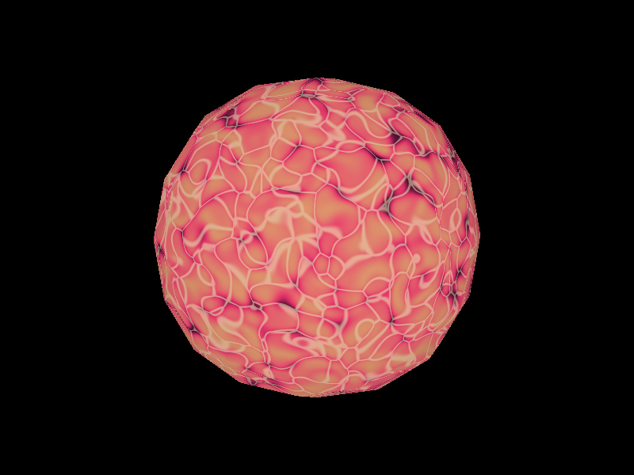
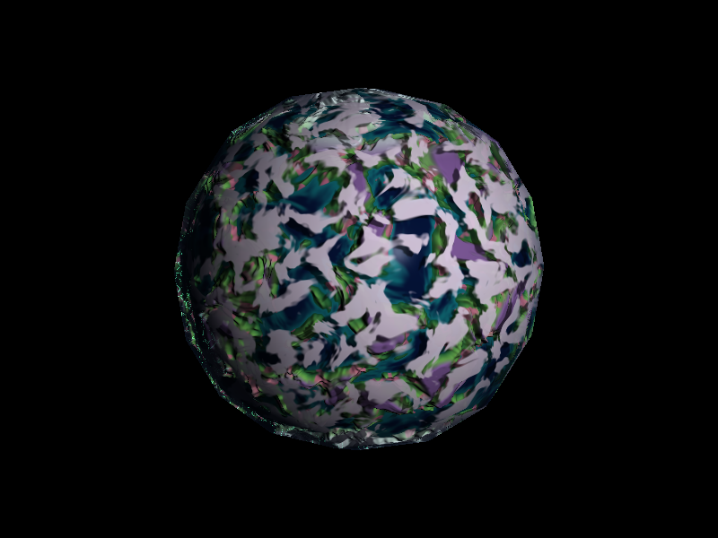
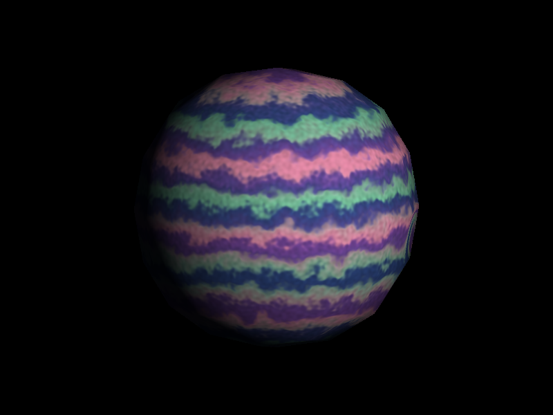

# Laboratorio: planetas y estrellas con shaders

Rasterizador por software escrito en Rust: todo se dibuja en CPU. La misma
esfera (`assets/models/sphere.obj`, 192 triángulos) se pinta con distintos
fragment shaders, y cada shader es un cuerpo celeste. El planeta rocoso tiene
dos lunas que giran y orbitan; el gigante gaseoso tiene dos anillos blancos
concentricos en el ecuador. No se usan texturas: el aspecto de las superficies
sale de funciones matemáticas y ruido.

> El laboratorio anterior (la nave, los rellenos y sus mediciones) está en la
> rama `feat/obj-rendering`.

## Cómo ejecutarlo

```sh
cargo run --release
```

La primera compilación construye raylib desde C, así que necesita CMake y un
compilador de C (en Windows, las Build Tools de Visual Studio).

Para guardar una captura de cada shader en `assets/capturas/` sin abrir la
ventana (el número es el instante, en segundos):

```sh
cargo run --release -- --capturas 2.0
```

## Controles

| Tecla | Qué hace |
|---|---|
| **Tab** / **Shift+Tab** | siguiente / anterior shader |
| **1**–**7** | elegir un shader directamente |
| **Flechas** | orbitar la cámara alrededor de la esfera |
| **Z** / **X** | alejar / acercar |
| **Q** / **E** | mover el sol alrededor de la esfera |
| **Espacio** | pausar el tiempo |
| **R** | volver al inicio |
| **P** | guardar una captura del shader actual |

Arriba a la izquierda se ve el nombre del cuerpo celeste y su tipo. Ese
texto no entra en las capturas.

## Cómo está armado

```
vértices → vertex shader → ensamblaje → rasterización → z-buffer → fragment shader → framebuffer
```

- **Vertex shader** (`src/shaders/mod.rs`): la matriz de modelo lleva la
  esfera a radio 1 en el origen, la de vista la mira desde la cámara orbital
  y la de viewport la pasa a píxeles (proyección ortográfica).
- **Rasterización** (`src/triangle.rs`): relleno baricéntrico que interpola
  la profundidad, la posición en el modelo y la posición en el mundo.
- **Z-buffer**: queda el fragmento más cercano de cada píxel, y el fragment
  shader corre una sola vez por píxel visible, repartido entre todos los
  núcleos (`Framebuffer::shade`).
- **Fragment shader**: arma un `Frag` con todo lo que se sabe del punto y
  llama al shader elegido con Tab.
- **Accesorios**: las lunas y los anillos son mallas adicionales que pasan
  por la misma rasterización y prueba de profundidad del planeta; sus
  transformaciones dependen del tiempo de la escena.

La esfera no gira: lo que se mueve es la cámara. El sol queda fijo respecto
a la esfera, así que al orbitar se ven el lado de día y el de noche. La
normal se calcula desde la posición (en una esfera es la dirección desde el
centro), por eso la luz se ve suave aunque la malla tenga pocos triángulos.

## Cómo escribir un shader

Un shader es una función `fn shade(f: &Frag) -> Vector3` en
`src/shaders/`. Recibe el punto que se está pintando y devuelve su color
como `Vector3`: x = rojo, y = verde, z = azul, de 0 a 1. Lo que pase de 1 se
comprime hacia el blanco, útil para que una estrella brille.

### Lo que trae `Frag`

| | Qué es |
|---|---|
| `f.p` | punto de la esfera de radio 1, en coordenadas del modelo. Es la entrada de todos los patrones |
| `f.normal` | normal en el mundo |
| `f.to_sun` | dirección hacia el sol |
| `f.to_viewer` | dirección hacia la cámara |
| `f.light` | intensidad del sol en ese punto: 0 de noche, 1 de frente |
| `f.time` | segundos desde que arrancó (Espacio lo pausa) |
| `f.lit(color)` | el color con luz difusa básica (ambiente + sol) |
| `f.shade(color, &material, normal)` | Lambert + Phong + emisión con un `Material` y la normal que se quiera |

### Herramientas (`src/shaders/kit.rs`)

| Función | Qué hace |
|---|---|
| `Vector3::new(1.0, 0.5, 0.0)`, `gray(v)` | colores (naranja, gris) |
| `mix(a, b, t)` | `a` cuando t = 0, `b` cuando t = 1 |
| `ramp(&[(0.0, a), (0.5, b), (1.0, c)], t)` | degradado por paradas |
| `smoothstep(e0, e1, x)`, `step(borde, x)` | convertir un valor en máscara, suave o dura |
| `wave(x)` | seno pasado a 0..1 |
| `fract(x)` | 0..1 que se repite |
| `noise(p)` | ruido OpenSimplex2, 0..1 |
| `fbm(p, octavas)` | varias octavas de ruido: más detalle |
| `ridged(p, octavas)` | como `fbm` pero con crestas finas y nítidas: venas, relámpagos |
| `cellular(p)` | distancia al centro de la celda (Voronoi) |
| `cell_edge(p)` | distancia al borde entre celdas: 0 sobre el borde |
| `cell_value(p)` | un valor al azar por celda |
| `latitude(p)`, `longitude(p)` | -1..1 de polo a polo, 0..1 alrededor |
| `rotate_y(p, ángulo)`, `rotate(p, eje, ángulo)` | girar el patrón |
| `rim(f, potencia)` | 0 de frente, 1 en el borde: halos, coronas, atmósferas |
| `bump(f.normal, p, h, fuerza, altura)` | normal con relieve a partir de un campo de altura |
| `Material::matte()`, `polished()`, `lacquer()`, `metal()`, `lamp(emisión)` | cómo responde a la luz |
| `Material::new(Albedo::new(difuso, especular), brillo)` | un material a medida |

Con vectores: `f.p * 4.0` sube la frecuencia de un patrón, `f.p + f.time * 0.3`
lo desplaza con el tiempo y `f.p * Vector3::new(1.0, 8.0, 1.0)` lo estira.

### Capas

Una capa es una máscara de 0 a 1, un color y una forma de combinarlos:

```rust
use super::kit::*;

pub fn shade(f: &Frag) -> Vector3 {
    let mut color = Vector3::new(0.11, 0.14, 0.25);

    // encima: mix
    let franjas = wave(f.p.y * 12.0 + f.time);
    color = mix(color, Vector3::new(0.36, 0.48, 0.84), franjas);

    // sumar: brillos, emisión
    let calor = fbm(f.p * 4.0, 4);
    color = color + Vector3::new(1.0, 0.7, 0.28) * calor * 0.3;

    // multiplicar: oscurecer, sombras
    color = color * (0.6 + 0.4 * cellular(f.p * 6.0));

    // la luz al final (una estrella puede saltársela)
    f.lit(color)
}
```

Para ver solo un patrón, devolverlo en gris: `return gray(franjas);`.

`src/shaders/sandbox.rs` (**pruebas** en Tab) es un shader para jugar sin
tocar los tres cuerpos.

### Agregar otro shader

1. Crear `src/shaders/mi_shader.rs` con `use super::kit::*;` y
   `pub fn shade(f: &Frag) -> Vector3`.
2. En `src/shaders/mod.rs`, agregar `mod mi_shader;` y una línea en
   `SHADERS`: `name` es el tipo (y el nombre de la captura) y `body` el
   nombre que se muestra en pantalla. Tab lo recorre solo.

### Dónde engancha cada efecto

| Efecto | Qué usar |
|---|---|
| Material animado | `f.time` dentro del patrón |
| Día y noche | `f.light` como máscara (por ejemplo, algo visible solo donde es casi 0) |
| Respuestas distintas a la luz | `f.shade` con un `Material` distinto según la región |
| Nubes | otra máscara de ruido sobre `rotate_y(f.p, f.time * velocidad)` |
| Tormenta o vórtice | girar `p` alrededor de un punto, más cerca más giro, antes de calcular las bandas |
| Bump mapping | una normal nueva a partir de cómo cambia un campo de altura, pasada a `f.shade` |
| Parallax | mover `p` según `f.to_viewer` y la altura antes de muestrear |
| Sombras de nubes | la máscara de nubes evaluada en `p` corrido hacia `f.to_sun` |

## Cuerpos celestes

### Estrella: Lunan't


"Luna" + "n't": no es una luna, porque brilla sola. Es una estrella morada
con venas de plasma lavanda que fluyen rápido sobre un fondo gris oscuro,
y late.

**Patrones y cómo se combinan.**

1. `ridged(p, 5)`: un `fbm` de crestas. Cada octava es `1 - |ruido|`, así
   que donde el ruido cruza por cero queda una cresta, y al elevarla al
   cuadrado se angosta. Eso da venas con borde nítido en vez de las manchas
   difuminadas de un `fbm` común. p gira (`SPIN`) y se desplaza con el
   tiempo (`FLOW_SPEED`), así que las venas fluyen.
2. `smoothstep(VEINS)` convierte las crestas en calor de 0 a 1, y un `ramp`
   lo lleva de gris oscuro a morado y a lavanda. Los morados están en
   escala 0–255, muy por encima de 1: la pantalla los comprime sin cambiar
   el tono, así que apenas hay calor el color salta a morado saturado y el
   gris solo queda donde el calor es 0.
3. El borde de la esfera se oscurece un poco (`0.65 + 0.35 · √(normal · vista)`).
4. Pulso: `1 + PULSE · sin(1.2 · t)`. Las venas lo reciben completo; el
   fondo solo recibe la mitad que oscurece, así que en el pico no se aclara.
5. No usa la luz del sol: todo es emisión.

**Parámetros** (`src/shaders/star.rs`):

| Parámetro | Qué cambia |
|---|---|
| `SPIN` | velocidad de giro de la superficie (rad/s) |
| `FLOW_SPEED` | qué tan rápido fluyen las venas |
| `SCALE` | tamaño del plasma: más alto, venas más chicas y juntas |
| `VEINS` | dónde empieza y termina el paso a morado: más cerrado, más fondo gris |
| `BRIGHTNESS` | brillo total |
| `PULSE` | cuánto late |
| `DARK`, `PURPLE`, `PURPLE_HOT` | colores del fondo, del plasma y de las venas |

### Planeta rocoso: Bocchi


Un planeta *rock* rosado: casi todo el suelo es rosa, con algunos lagos
celestes y picos y casquetes polares de plata. Las nubes lo tapan a ratos y de noche
se le encienden grietas celestes.

**Patrones y cómo se combinan.**

1. `terrain`: `fbm` de 4 octavas, la altura del suelo. Debajo de
   `SEA_LEVEL` hay agua (celeste, más oscura cuanto más honda, con espuma en
   la costa); arriba, roca que va de rosa claro a malva según la altura.
2. Plata: sobre `PEAK_LEVEL` y cerca de los polos (`ICE_LATITUDE`,
   desplazada por la altura para que el borde del casquete no sea recto).
3. Relieve: `bump` inclina la normal según la pendiente de `terrain`. La
   altura se corta en `SEA_LEVEL`, así que el mar queda plano.
4. Cada región responde distinto a la luz: agua con brillo de Phong
   cerrado, roca mate y plata metálica (el brillo sale plateado).
5. Nubes: otro `fbm`, estirado en vertical para que salgan alargadas y
   girando a `CLOUD_SPEED`, distinto del giro del suelo (`SPIN`). Su sombra
   es la misma máscara evaluada en el punto corrido hacia el sol.
6. Noche: `cell_edge` dibuja grietas que solo brillan donde `f.light` es
   casi 0.
7. Un halo rosado en el borde con `rim`, más fuerte del lado del día.

**Parámetros** (`src/shaders/rocky.rs`):

| Parámetro | Qué cambia |
|---|---|
| `SPIN` | velocidad de giro del suelo |
| `TERRAIN_SCALE` | tamaño de los continentes |
| `SEA_LEVEL` | cuánto mar hay |
| `PEAK_LEVEL` | desde qué altura los picos son de plata |
| `ICE_LATITUDE` | hasta dónde bajan los casquetes |
| `BUMP` | fuerza del relieve |
| `CLOUD_SCALE`, `CLOUD_COVER` | tamaño de las nubes y cuánto cubren |
| `CLOUD_SPEED` | velocidad de las nubes |
| `CLOUD_HEIGHT` | qué tan corrida queda la sombra de las nubes |
| `CRACK_SCALE`, `NIGHT_GLOW` | tamaño e intensidad de las grietas de noche |
| `CELESTE`, `SEA_DEEP`, `PINK`, `HOT_PINK`, `SILVER`, ... | paleta |

### Gigante gaseoso: JupyterNotebook


Un Júpiter cibernético pintado con la paleta Dracula, un tema de editor de
código: franjas anchas de neón (verde, cyan, rosa y morado) separadas por
líneas finas casi negras, que son los fondos del tema. Las franjas bajan,
los colores van cambiando con el tiempo y unas vetas oscuras de nubes le dan
la textura de gas.

**Patrones y cómo se combinan.**

1. `franjas = wave(y · BANDS + t · FALL_SPEED + remolino)³`: un seno de la
   altura más el tiempo. Como el tiempo suma, cada valor queda cada vez más
   abajo: las franjas bajan. Al elevarlo al cubo, solo se acerca a 1 en una
   parte angosta de cada ciclo.
2. Remolino: un `fbm` estirado en vertical que se suma dentro del seno y
   ondula los bordes, para que parezcan gas.
3. Color: `mix(neón, oscuro, franjas)`. Como `franjas` casi siempre está
   cerca de 0, domina el neón y lo oscuro queda en líneas finas. Cada color
   sale de `cycle`, que recorre su lista en círculo con un índice que
   depende de la altura (cada franja tiene su color) y del tiempo
   (`COLOR_SPEED`). El neón y lo oscuro avanzan a ritmos distintos, así que
   las combinaciones no se repiten igual.
4. Vetas: otro `fbm` más fino multiplica el color entre 0.4 y 1.2, y deja
   nubes oscuras alargadas sobre el neón.
5. `Material::lamp(GLOW)`: además de la luz del sol, la superficie emite su
   propio color, así que el neón brilla también del lado de noche. Las
   líneas oscuras casi no emiten.

**Parámetros** (`src/shaders/gas_giant.rs`):

| Parámetro | Qué cambia |
|---|---|
| `BANDS` | cuántas franjas hay |
| `FALL_SPEED` | qué tan rápido bajan las franjas |
| `TURBULENCE` | qué tan ondulados son los bordes |
| `COLOR_SPEED` | qué tan rápido cambian los colores |
| `GLOW` | cuánto brilla solo: más alto, neón más vivo, pero las líneas oscuras se aclaran |
| `LIGHT`, `DARK` | colores del neón y de las líneas oscuras (paleta Dracula) |

### Estrella: Flora



Una estrella inspirada en una flor: células rosadas y durazno sobre un fondo
ciruela, unidas por filamentos cálidos. Su superficie evoluciona y pulsa sin
mover los vértices ni depender de la luz del sol.

**Patrones y cómo se combinan.**

1. `flow`: tres muestras de ruido con desplazamientos temporales diferentes
deforman las coordenadas de entrada. La deformación cambia la forma de las
células, no solamente su color.
2. `cellular(q)` produce las zonas calientes alrededor de los centros de las
celdas; `cell_edge(q)` genera una red de filamentos sobre sus bordes.
3. Una onda de la altura, modulada por la deformación y el tiempo, agrega
variaciones semejantes a pétalos. Se combina con las células para obtener
el calor que selecciona los colores ciruela, rosa y durazno.
4. Los filamentos mezclan el color base con un tono crema. El borde de la
esfera se oscurece según la dirección de vista para dar sensación de volumen.
5. Un pulso suave modifica la intensidad. Todo el color es emisivo: mover
el sol no apaga la estrella.

**Parámetros** (`src/shaders/flora.rs`):

| Parámetro | Qué cambia |
|---|---|
| `CELL_SCALE` | frecuencia de las células: más alto, células más pequeñas |
| `WARP_STRENGTH` | cuánto se deforman las células y sus filamentos |
| `FLOW_SPEED` | velocidad de evolución del patrón |
| `FILAMENT_STRENGTH` | intensidad de la mezcla de los filamentos cálidos |
| `PLUM, ROSE, PEACH, CREAM` | paleta del fondo, zonas calientes y filamentos |

### Planeta rocoso: Veridia



Un mundo de océanos azules y turquesa, vegetación verde, campos rosados,
cordilleras violetas e hielo polar. Las nubes se desplazan sobre un terreno
fijo y, de noche, se ilumina una red de filamentos verdes en los continentes.

**Patrones y cómo se combinan.**

1. `terrain`: un `fbm` de cuatro octavas, con coordenadas deformadas por ruido,
   determina la altura. `SEA_LEVEL` separa océano y tierra con una transición
   suave; otros umbrales seleccionan montañas e hielo.
2. Un campo de humedad independiente distribuye campos florales rosados sobre
   la vegetación. No se usa solamente la misma altura para todos los biomas.
3. `parallax`: recorre capas de profundidad en la dirección tangencial de
   `f.to_viewer` hasta cruzar el campo `1 - height`. El terreno se muestrea en
   la coordenada desplazada: sus detalles cambian de posición aparente con
   la cámara, sin mover vértices ni usar el tiempo para ese desplazamiento.
4. `terrain_normal`: diferencias centrales de la altura en dos tangentes
   inclinan la normal. Esa normal produce el relieve aparente al iluminar
   la tierra; la máscara terrestre conserva el océano sin ese relieve.
5. El océano usa un material con reflejo de Phong y la vegetación y roca usan
   un material mate. Por eso las regiones responden de manera diferente a la luz.
6. `cloud_mask`: otro campo de ruido gira a `CLOUD_SPEED`, independiente de
   los continentes. `CLOUD_COVERAGE` ajusta cuánto cielo queda cubierto.
7. `shell_point`: calcula dónde un rayo alcanza una altura esférica analítica.
   Hacia la cámara se muestrea la nube visible; hacia el sol se muestrea la
   nube que bloquea la luz. Ambas consultas usan la misma máscara, altura y
   tiempo, de modo que las sombras corresponden a las nubes. No se agrega
   una segunda malla.
8. `cell_edge` dibuja los filamentos bioluminiscentes. Una máscara basada en
   `dot(normal, to_sun)` los activa en el lado nocturno y los desvanece al
   amanecer. Las nubes se mezclan después y se añade un halo azul suave.

**Parámetros** (`src/shaders/veridia.rs`):

| Parámetro | Qué cambia |
|---|---|
| `SEA_LEVEL`, `TERRAIN_SCALE` | proporción de océano y tamaño de los continentes |
| `BUMP_STRENGTH` | fuerza del relieve de normales; 0 lo desactiva |
| `PARALLAX_DEPTH` | profundidad aparente dependiente de la vista; 0 la desactiva |
| `PARALLAX_STEPS` | cantidad de capas de búsqueda: más capas aumentan el trabajo por fragmento |
| `CLOUD_COVERAGE` | cobertura: 0 despejado y 1 completamente cubierto |
| `CLOUD_SPEED` | velocidad de las nubes respecto al terreno fijo |
| `CLOUD_HEIGHT` | altura analítica que determina la separación entre nubes y sombras |
| `SHADOW_STRENGTH` | intensidad de las sombras; 0 las desactiva sin quitar las nubes |
| `NIGHT_GLOW` | intensidad de la bioluminiscencia nocturna |
| `OCEAN_SPECULAR` | fuerza del reflejo especular del océano |
| `DEEP_BLUE`, `TURQUOISE`, `FOREST`, `MEADOW`, `BLOSSOM`, `MOUNTAIN`, `ICE`, `CLOUD`, `GLOW` | paleta de las regiones y efectos |

El parallax es una aproximación local: no modifica la silueta ni agrega
geometría. El relieve y el desplazamiento usan el marco del modelo actual,
con escala uniforme y sin rotación de la malla.

### Gigante gaseoso: Iris



Una atmósfera de bandas azules, verde menta, lavanda y rosado. Las corrientes
se ondulan suavemente y una tormenta elíptica curva las franjas a su alrededor.

**Patrones y cómo se combinan.**

1. `vortex`: expresa el punto en una base local centrada en la tormenta. La
   distancia elíptica controla un giro que disminuye suavemente hasta cero
   fuera de la región. Una máscara evita repetir la tormenta en el lado opuesto.
2. Las coordenadas deformadas se usan antes de evaluar las bandas. Así se
   curvan las franjas existentes, en lugar de pintar un círculo de otro color.
3. Un seno de la altura produce las bandas. Un `fbm` de baja frecuencia
   ondula sus bordes y otro ruido más fino agrega detalle. El ruido se
   desplaza lentamente con el tiempo.
4. La máscara de bandas mezcla azul con menta y lavanda con rosa. Una
   segunda onda mezcla esas dos paletas, manteniendo transiciones suaves.
5. El detalle fino modula el color y `f.lit` aplica la iluminación mate del
   proyecto. Iris no usa anillos ni geometría adicional.

**Parámetros** (`src/shaders/iris.rs`):

| Parámetro | Qué cambia |
|---|---|
| `BAND_FREQUENCY` | cantidad de bandas: más alto, bandas más finas |
| `TURBULENCE` | cuánto se ondulan los bordes de las bandas |
| `FLOW_SPEED` | velocidad de evolución del ruido atmosférico |
| `VORTEX_STRENGTH` | intensidad del giro localizado; 0 desactiva la tormenta |
| `VORTEX_WIDTH`, `VORTEX_HEIGHT` | ancho y alto de la región elíptica |
| `BLUE`, `MINT`, `LAVENDER`, `PINK` | paleta de la atmósfera |

## Efectos adicionales

Las rutas de shader de esta tabla son relativas a `src/shaders/`. Cada efecto
se solicita una sola vez por entrega, aunque aparezca en varios cuerpos.


| Efecto | Cuerpo | Archivo y función | Evidencia | Cómo funciona | Parámetro y qué cambia |
|---|---|---|---|---|---|
| Material animado | Lunan't, Bocchi, JupyterNotebook, Flora e Iris | `star.rs`, `rocky.rs`, `gas_giant.rs`, `flora.rs`, `iris.rs` → `shade`; Flora también usa `flow` | [Video](assets/videos/shaders_demo.mp4), **00:00–00:05**, **00:16–00:20** y **00:25–00:32**: evolución de plasma, colores y células | El tiempo desplaza plasma, suelo o bandas; Flora deforma sus células y pulsa; Iris evoluciona su ruido. No se cuenta nuevamente el movimiento exigido para las nubes | `FLOW_SPEED`, `PULSE`, `SPIN`, `FALL_SPEED`, `COLOR_SPEED`; en Flora, `WARP_STRENGTH` cambia la deformación |
| Día y noche | Bocchi y Veridia | `rocky.rs`, `veridia.rs` → `shade` | [Video](assets/videos/shaders_demo.mp4), **00:08–00:10**, **00:33–00:34** y **00:38–00:40**: filamentos luminosos en regiones oscuras | Bocchi usa grietas pesadas por `f.light`; Veridia usa el producto firmado entre normal y dirección solar para activar filamentos verdes solo de noche | `NIGHT_GLOW`: intensidad; en Bocchi, `CRACK_SCALE`: tamaño |
| Respuesta distinta a la luz por región | Bocchi y Veridia | `rocky.rs`, `veridia.rs` → `shade` | [Video](assets/videos/shaders_demo.mp4), **00:06–00:15** y **00:33–00:40**: vistas generales de las regiones; la diferencia especular/mate no queda aislada con claridad | Bocchi combina agua con Phong, roca mate y plata metálica; Veridia combina océano especular con tierra mate | `SEA_LEVEL`: distribución de regiones; `PEAK_LEVEL` en Bocchi; `OCEAN_SPECULAR` en Veridia |
| Nubes | Bocchi y Veridia | `rocky.rs` → `clouds`; `veridia.rs` → `cloud_mask`, `shade` | [Video](assets/videos/shaders_demo.mp4), **00:06–00:15** y **00:33–00:40**: se aprecia la cubierta; los cambios de vista dificultan separar su movimiento del terreno | Máscaras de ruido con movimiento propio; Veridia permite variar la cobertura entre cielo despejado y cubierto | `CLOUD_SPEED`; `CLOUD_COVER` en Bocchi; `CLOUD_COVERAGE` en Veridia |
| Sombras de nubes | Bocchi y Veridia | `rocky.rs` → `shade`; `veridia.rs` → `shell_point`, `cloud_mask`, `shade` | [Video](assets/videos/shaders_demo.mp4), **00:33–00:40**: vista general; no demuestra de forma concluyente el desplazamiento de la sombra respecto a las nubes al variar solo la luz | Bocchi desplaza la consulta hacia el sol; Veridia intersecta la dirección solar con una altura analítica y consulta la misma máscara que las nubes visibles | `CLOUD_HEIGHT`: separación; `SHADOW_STRENGTH` en Veridia: oscuridad |
| Bump mapping | Bocchi y Veridia | `kit.rs` → `bump`, `rocky.rs` → `terrain`; `veridia.rs` → `terrain_normal`, `height` | [Video](assets/videos/shaders_demo.mp4), **00:06–00:15** y **00:33–00:40**: superficie sombreada; no hay una comparación que aísle la contribución de las normales perturbadas | Diferencias finitas de altura inclinan la normal de iluminación sin cambiar los vértices; Veridia usa diferencias centrales | `BUMP` en Bocchi; `BUMP_STRENGTH` en Veridia: fuerza del relieve |
| Tormenta o vórtice localizado | Iris | `iris.rs` → `vortex`, `shade` | [Video](assets/videos/shaders_demo.mp4), **00:43–00:45**: las bandas se curvan alrededor de una región localizada; [captura](assets/capturas/iris.png) | Una rotación local, limitada por distancia elíptica, deforma las coordenadas antes de generar las bandas | `VORTEX_STRENGTH`: intensidad; `VORTEX_WIDTH`, `VORTEX_HEIGHT`: extensión |
| Parallax dependiente de la vista | Veridia | `veridia.rs` → `parallax`, `height`, `shade` | [Video](assets/videos/shaders_demo.mp4), **00:33–00:40**: cambia el punto de vista, pero no permite distinguir inequívocamente parallax de movimiento normal de cámara y animación | Marcha por capas hasta cruzar el campo de altura; desplaza el muestreo según la vista y sugiere profundidad sin cambiar la malla | `PARALLAX_DEPTH`: profundidad; `PARALLAX_STEPS`: pasos de búsqueda |

Los videos se pueden grabar con **Win + Alt + R** (Xbox Game Bar) con la
ventana enfocada.
