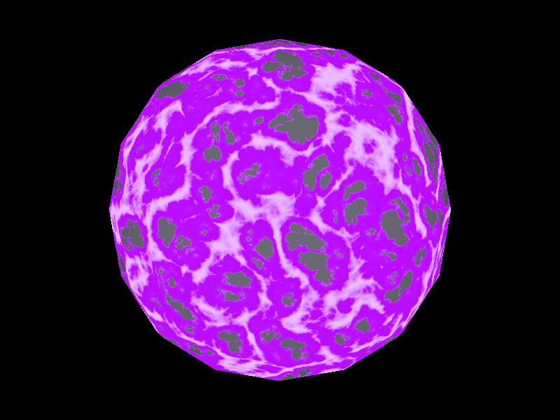
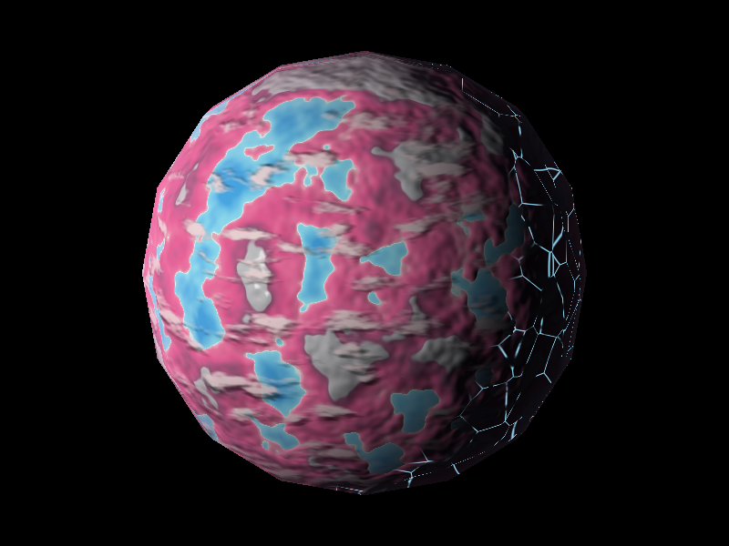
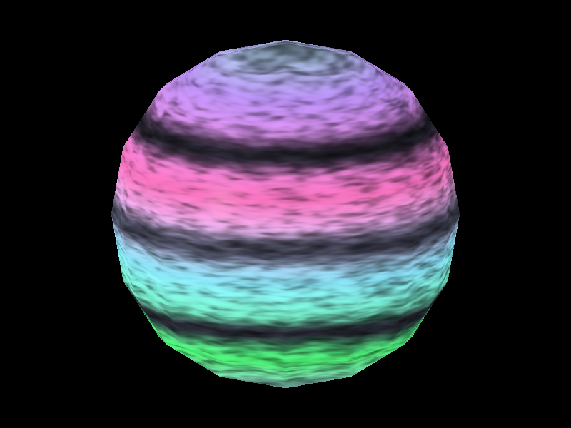

# Laboratorio: planetas y estrellas con shaders

Rasterizador por software escrito en Rust: todo se dibuja en CPU. La misma
esfera (`assets/models/sphere.obj`, 192 triángulos) se pinta con distintos
fragment shaders, y cada shader es un cuerpo celeste. No se usan texturas ni
se modifican los vértices: todo el aspecto sale de funciones matemáticas y
ruido.

> El laboratorio anterior (la nave, los rellenos y sus mediciones) está en la
> rama `feat/obj-rendering`.

## Cómo ejecutarlo

```sh
cargo run --release
```

La primera compilación construye raylib desde C, así que necesita CMake y un
compilador de C (en Windows, las Build Tools de Visual Studio).

Para guardar una captura de cada shader en `assets/capturas/` sin abrir la
ventana (el número es el instante, en segundos):

```sh
cargo run --release -- --capturas 2.0
```

## Controles

| Tecla | Qué hace |
|---|---|
| **Tab** / **Shift+Tab** | siguiente / anterior shader |
| **1**–**4** | elegir un shader directamente |
| **Flechas** | orbitar la cámara alrededor de la esfera |
| **Z** / **X** | alejar / acercar |
| **Q** / **E** | mover el sol alrededor de la esfera |
| **Espacio** | pausar el tiempo |
| **R** | volver al inicio |
| **P** | guardar una captura del shader actual |

## Cómo está armado

```
vértices → vertex shader → ensamblaje → rasterización → z-buffer → fragment shader → framebuffer
```

- **Vertex shader** (`src/shaders/mod.rs`): la matriz de modelo lleva la
  esfera a radio 1 en el origen, la de vista la mira desde la cámara orbital
  y la de viewport la pasa a píxeles (proyección ortográfica).
- **Rasterización** (`src/triangle.rs`): relleno baricéntrico que interpola
  la profundidad, la posición en el modelo y la posición en el mundo.
- **Z-buffer**: queda el fragmento más cercano de cada píxel, y el fragment
  shader corre una sola vez por píxel visible, repartido entre todos los
  núcleos (`Framebuffer::shade`).
- **Fragment shader**: arma un `Frag` con todo lo que se sabe del punto y
  llama al shader elegido con Tab.

La esfera no gira: lo que se mueve es la cámara. El sol queda fijo respecto
a la esfera, así que al orbitar se ven el lado de día y el de noche. La
normal se calcula desde la posición (en una esfera es la dirección desde el
centro), por eso la luz se ve suave aunque la malla tenga pocos triángulos.

## Cómo escribir un shader

Un shader es una función `fn shade(f: &Frag) -> Rgb` en `src/shaders/`.
Recibe el punto que se está pintando y devuelve su color (0 a 1 por canal;
lo que pase de 1 se comprime hacia el blanco, útil para que una estrella
brille).

### Lo que trae `Frag`

| | Qué es |
|---|---|
| `f.p` | punto de la esfera de radio 1, en coordenadas del modelo. Es la entrada de todos los patrones |
| `f.normal` | normal en el mundo |
| `f.to_sun` | dirección hacia el sol |
| `f.to_viewer` | dirección hacia la cámara |
| `f.light` | intensidad del sol en ese punto: 0 de noche, 1 de frente |
| `f.time` | segundos desde que arrancó (Espacio lo pausa) |
| `f.lit(color)` | el color con luz difusa básica (ambiente + sol) |
| `f.shade(color, &material, normal)` | Lambert + Phong + emisión con un `Material` y la normal que se quiera |

### Herramientas (`src/shaders/kit.rs`)

| Función | Qué hace |
|---|---|
| `rgb(r, g, b)`, `hex(0xff8800)`, `gray(v)` | colores |
| `mix(a, b, t)` | `a` cuando t = 0, `b` cuando t = 1 |
| `ramp(&[(0.0, a), (0.5, b), (1.0, c)], t)` | degradado por paradas |
| `smoothstep(e0, e1, x)`, `step(borde, x)` | convertir un valor en máscara, suave o dura |
| `wave(x)` | seno pasado a 0..1 |
| `fract(x)` | 0..1 que se repite |
| `noise(p)` | ruido OpenSimplex2, 0..1 |
| `fbm(p, octavas)` | varias octavas de ruido: más detalle |
| `cellular(p)` | distancia al centro de la celda (Voronoi) |
| `cell_edge(p)` | distancia al borde entre celdas: 0 sobre el borde |
| `cell_value(p)` | un valor al azar por celda |
| `latitude(p)`, `longitude(p)` | -1..1 de polo a polo, 0..1 alrededor |
| `rotate_y(p, ángulo)`, `rotate(p, eje, ángulo)` | girar el patrón |
| `Material::matte()`, `polished()`, `lacquer()`, `metal()`, `lamp(emisión)` | cómo responde a la luz |

Con vectores: `f.p * 4.0` sube la frecuencia de un patrón, `f.p + f.time * 0.3`
lo desplaza con el tiempo y `f.p * Vector3::new(1.0, 8.0, 1.0)` lo estira.

### Capas

Una capa es una máscara de 0 a 1, un color y una forma de combinarlos:

```rust
use super::kit::*;

pub fn shade(f: &Frag) -> Rgb {
    let mut color = hex(0x1b2440);

    // encima: mix
    let franjas = wave(f.p.y * 12.0 + f.time);
    color = mix(color, hex(0x5d7bd5), franjas);

    // sumar: brillos, emisión
    let calor = fbm(f.p * 4.0, 4);
    color = color + hex(0xffb347) * calor * 0.3;

    // multiplicar: oscurecer, sombras
    color = color * (0.6 + 0.4 * cellular(f.p * 6.0));

    // la luz al final (una estrella puede saltársela)
    f.lit(color)
}
```

Para ver solo un patrón, devolverlo en gris: `return gray(franjas);`.

`src/shaders/sandbox.rs` (**pruebas** en Tab) es un shader para jugar sin
tocar los tres cuerpos.

### Agregar otro shader

1. Crear `src/shaders/mi_shader.rs` con `use super::kit::*;` y
   `pub fn shade(f: &Frag) -> Rgb`.
2. En `src/shaders/mod.rs`, agregar `mod mi_shader;` y una línea en
   `SHADERS`. Tab lo recorre solo.

### Dónde engancha cada efecto

| Efecto | Qué usar |
|---|---|
| Material animado | `f.time` dentro del patrón |
| Día y noche | `f.light` como máscara (por ejemplo, algo visible solo donde es casi 0) |
| Respuestas distintas a la luz | `f.shade` con un `Material` distinto según la región |
| Nubes | otra máscara de ruido sobre `rotate_y(f.p, f.time * velocidad)` |
| Tormenta o vórtice | girar `p` alrededor de un punto, más cerca más giro, antes de calcular las bandas |
| Bump mapping | una normal nueva a partir de cómo cambia un campo de altura, pasada a `f.shade` |
| Parallax | mover `p` según `f.to_viewer` y la altura antes de muestrear |
| Sombras de nubes | la máscara de nubes evaluada en `p` corrido hacia `f.to_sun` |

## Cuerpos celestes

### Estrella: _nombre_



_Descripción del diseño._

**Patrones y cómo se combinan.** _Pendiente._

**Parámetros** (`src/shaders/star.rs`):

| Parámetro | Qué cambia |
|---|---|
| | |

### Planeta rocoso: _nombre_



_Descripción del diseño._

**Patrones y cómo se combinan.** _Pendiente._

**Parámetros** (`src/shaders/rocky.rs`):

| Parámetro | Qué cambia |
|---|---|
| | |

### Gigante gaseoso: _nombre_



_Descripción del diseño._

**Patrones y cómo se combinan.** _Pendiente._

**Parámetros** (`src/shaders/gas_giant.rs`):

| Parámetro | Qué cambia |
|---|---|
| | |

## Efectos adicionales

| Efecto | Cuerpo | Archivo y función | Evidencia | Cómo funciona | Parámetro y qué cambia |
|---|---|---|---|---|---|
| | | | | | |

Los videos se pueden grabar con **Win + Alt + R** (Xbox Game Bar) con la
ventana enfocada.
