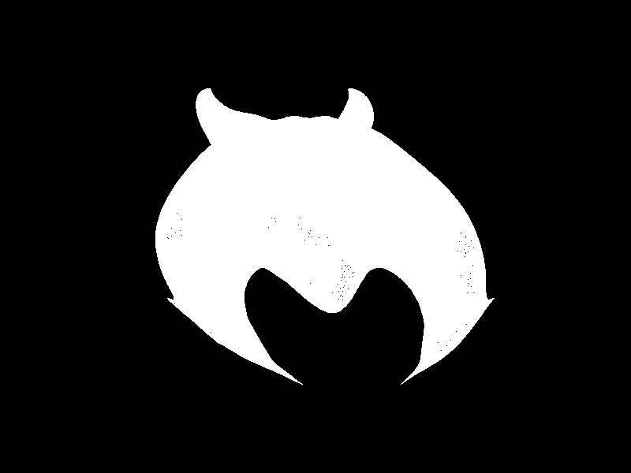
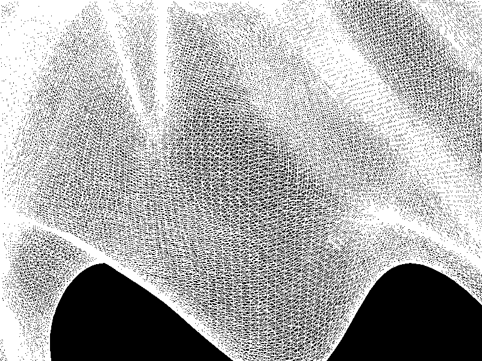
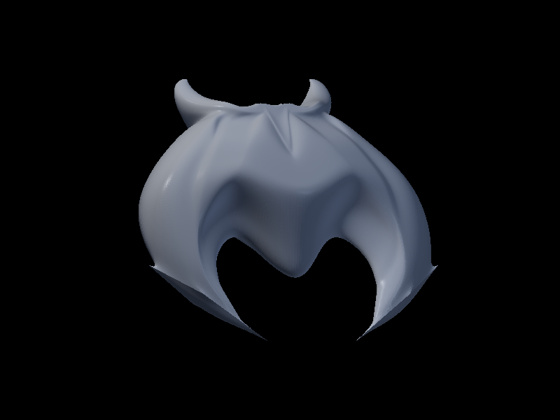

# Rasterizador de modelos .obj

Un rasterizador por software, escrito en Rust, que carga un modelo `.obj`
(`assets/models/nave-juanmontenegro-24750.obj`) y lo dibuja pasando por un
pipeline propio:

```
vértices → vertex shader → ensamblaje de triángulos → rasterización → fragment shader → framebuffer
```

La única dependencia es `raylib`, que se usa para abrir la ventana, subir el
cuadro a la pantalla y prestar sus tipos de vector y matriz.

> El trazador de rayos anterior (las islas de bloques) sigue en la rama
> `main`. De él se conservó la lógica de luces y sombras (`light.rs`,
> `shading.rs`, `material.rs`, `color.rs`), que aquí sombrea las caras
> rellenas.

## Cómo ejecutarlo

```sh
cargo run --release
```

## Controles

| Tecla | Qué hace |
|---|---|
| **Tab** | cambia entre contorno y relleno |
| **F** | cambia el algoritmo de relleno (baricéntrico / líneas horizontales) |
| **Flechas** | trasladar |
| **W/S**, **A/D**, **Q/E** | rotar en X, Y y Z |
| **Z** / **X** | achicar / agrandar |
| **R** | volver a la posición inicial |
| **P** | guardar una captura del modo actual |

## Laboratorio: rellenar triángulos

### Capturas

| Contorno | Contorno (acercado) |
|---|---|
|  |  |
| **Relleno baricéntrico** | **Relleno por líneas horizontales** |
|  |  |

Con la nave a su tamaño normal el contorno se ve como una mancha blanca: son
319 mil triángulos en unos 150 mil píxeles, así que las aristas lo tapan
todo. Al acercarse (tecla **X**) aparece la malla.

En el relleno cada cara toma un solo color (*flat shading*): el vertex shader
ilumina cada vértice con `shading::shade` (Lambert + Phong con las tres luces
del raytracer) y el triángulo usa el promedio de sus tres vértices. Un
z-buffer decide qué cara queda delante.

### Mediciones

```sh
cargo run --release -- --compare-triangles
cargo run --release -- --benchmark-triangles
```

**Comparación de posiciones.** `--compare-triangles` corre los casos de
prueba con los dos rellenos, compara los conjuntos de píxeles y repite con
los vértices en orden inverso:

```text
caso                      baricentr.      lineas  distintas  orden inverso
pequeno                           10          10          0          igual
grande                        172000      172000          0          igual
borde horizontal               15000       15000          0          igual
borde vertical                 16000       16000          0          igual
parcialmente fuera             40645       40645          0          igual
colineales                         0           0          0          igual
bordes sobre centros              45          45          0          igual
vertices fraccionarios          2199        2199          0          igual

cuadrado partido en dos triangulos (deberia dar 10000 y 0):
  baricentrico   pixeles:  10000   repetidos: 0
  por lineas     pixeles:  10000   repetidos: 0
```

**Tiempo de rasterización.** `--benchmark-triangles` hace el vertex shader y
el ensamblaje una sola vez y mide solo la rasterización de la nave completa
(20 pasadas por medición, mediana de 7 mediciones):

| Modo | Fragmentos | Mediana por pasada |
|---|---:|---:|
| contorno | 2 136 808 | 143,18 ms |
| relleno baricéntrico | 184 166 | 24,29 ms |
| relleno por líneas | 184 166 | 25,01 ms |

### Perfil

Tiempo de cada etapa del pipeline en un cuadro completo (mediana de 7
cuadros), con la nave a su tamaño normal y acercada 6 veces:

| Etapa | Contorno 1× | Baricéntrico 1× | Líneas 1× | Contorno 6× | Baricéntrico 6× | Líneas 6× |
|---|---:|---:|---:|---:|---:|---:|
| vertex shader | 26 ms | 97 ms | 96 ms | 26 ms | 100 ms | 92 ms |
| ensamblaje | 15 ms | 17 ms | 14 ms | 15 ms | 17 ms | 16 ms |
| rasterización | 132 ms | 23 ms | 24 ms | 318 ms | 283 ms | 184 ms |
| fragmentos (z-buffer + shader) | 12 ms | 2 ms | 2 ms | 32 ms | 29 ms | 30 ms |
| **total** | **186 ms** | **139 ms** | **137 ms** | **399 ms** | **446 ms** | **329 ms** |
| fragmentos generados | 2 136 808 | 184 166 | 184 166 | 7 738 436 | 6 630 776 | 6 630 776 |

El vertex shader cuesta unos 24 ms sin luces; en el relleno sube a unos
95 ms porque ilumina los 957 mil vértices.

Para ver **dónde** se va el tiempo dentro de cada etapa, el proyecto trae el
perfil `profiling` (release con símbolos de depuración). En Windows
`cargo flamegraph` usa ETW, así que hay que abrir la terminal como
administrador:

```sh
cargo install flamegraph
cargo flamegraph --profile profiling -- --benchmark-triangles
```

En `flamegraph.svg` conviene buscar `triangle_barycentric`,
`triangle_scanline`, `line` y `rasterize`, y comparar el ancho del cálculo
(`edge_function`, `cross_at`) con el de `push`, `extend` y la reserva de
memoria (`RawVec`, `reserve`): cada triángulo crea su propio `Vec` de
fragmentos y después se copia al grande.

### Diferencias encontradas

**La regla común.** Los dos rellenos responden igual a la pregunta "¿este
píxel está adentro?":

1. se prueba el **centro** de cada píxel, `(x + 0.5, y + 0.5)`;
2. un centro que cae justo sobre un borde se dibuja solo si el borde es
   **izquierdo** o **superior** (regla *top-left*, la misma de las GPU).

El baricéntrico lo aplica con las tres funciones de borde: un píxel entra si
los tres pesos son positivos, o cero sobre un borde superior o izquierdo. El
de líneas lo aplica por construcción: toma las filas con el centro en
`[arriba, abajo)` y, en cada fila, los píxeles con el centro en
`[izquierda, derecha)`, así que incluye el borde superior e izquierdo y
excluye el inferior y derecho. Los triángulos degenerados (tres vértices
alineados) se descartan antes de dividir entre su área, y el orden de los
vértices no importa.

**Por qué dan las mismas posiciones.** Como la regla es la misma, los casos
de prueba dan 0 posiciones distintas, también con el orden invertido, y el
cuadrado partido en dos cubre sus 10 000 píxeles sin hueco ni repetición. En
la nave completa los dos generan exactamente la misma lista de posiciones
(184 166 fragmentos a tamaño normal y 6 630 776 acercada). En la imagen final
a tamaño normal solo 4 píxeles de color cambian apenas un tono: la
profundidad se interpola en distinto orden (pesos baricéntricos contra
interpolación por filas), y en un empate de profundidad entre dos triángulos
vecinos el redondeo de `f32` puede hacer que el z-buffer elija el otro.
Acercada, las dos imágenes son idénticas.

**Por qué el contorno es el más lento con esta malla.** Genera 11,6 veces
más fragmentos que el relleno y tarda 5,9 veces más. Con la nave a su tamaño
normal casi todos los triángulos miden menos de un píxel: una línea genera
al menos un fragmento aunque mida menos de un píxel, mientras que un
triángulo que no cubre ningún centro no genera ninguno. Además cada arista se
dibuja dos veces, una por cada triángulo que la comparte. A ese tamaño los
dos rellenos tardan casi lo mismo porque hacen casi el mismo trabajo: el
rectángulo del baricéntrico tiene muy pocos píxeles y el de líneas recorre
una fila o ninguna. Ahí pesa más el vertex shader con luces (97 ms) que la
rasterización (23 ms).

**Qué cambia al acercarse.** Con la nave 6 veces más grande los triángulos
cubren muchos píxeles y el de líneas pasa a ser bastante más rápido: 184 ms
contra 283 ms de rasterización. El baricéntrico prueba todos los píxeles del
rectángulo que contiene al triángulo y descarta al menos la mitad (un
triángulo nunca ocupa más de la mitad de ese rectángulo); el de líneas solo
visita los píxeles de adentro.

**Ideas de mejora.** Pasar a cada función de relleno un `&mut Vec<Fragment>`
para que escriba directo en el vector grande, recortar el rectángulo y las
filas al tamaño de la ventana (hoy los fragmentos de afuera los descarta
`framebuffer.point`) y no clonar los vértices en el ensamblaje
(`[&Vertex; 3]` en vez de `[Vertex; 3]`).
