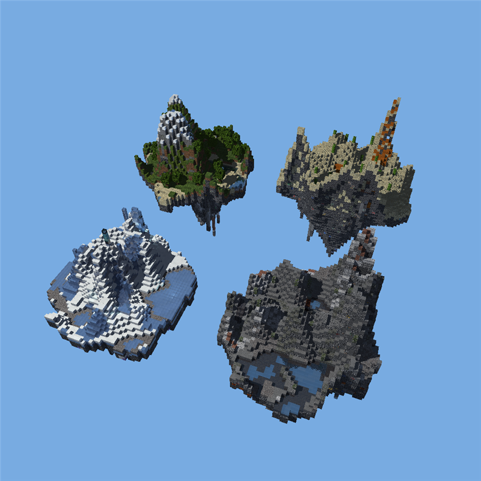
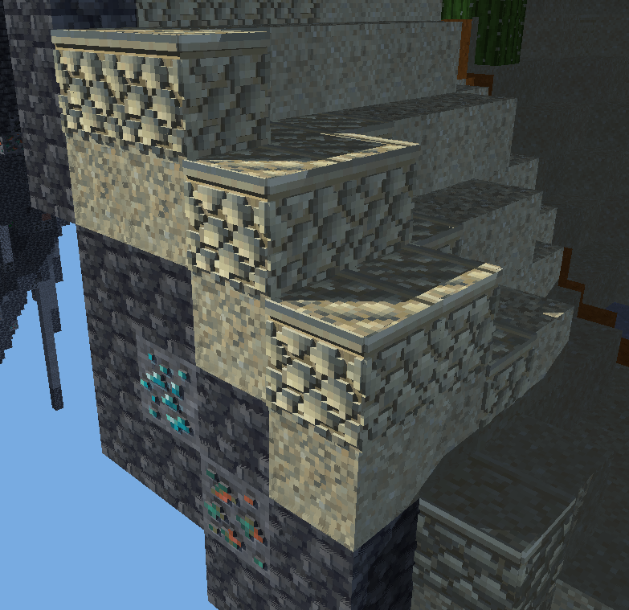
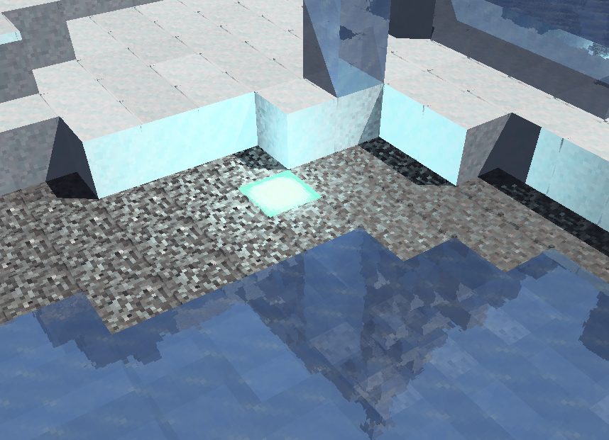

# Raytracer

Un trazador de rayos por CPU, escrito en Rust, que dibuja cuatro islas
flotantes de bloques generadas con ruido. Cada bloque es geometría de verdad:
el relieve del adoquín, las vetas de mineral y las piedras que sobresalen de
la roca son cajas que el trazador interseca, no un dibujo sobre una cara
plana.



## Demostración

https://youtu.be/Bn879OOaCaQ

<video src="assets/demo_video.mp4" controls="controls" width="100%"></video>

## Cómo ejecutarlo

Hace falta [Rust](https://rustup.rs/). La única dependencia es `raylib`, y se
usa nada más para abrir la ventana, subir el cuadro a la pantalla, leer los
PNG y prestar sus tipos de vector y color; todo el trazado es propio.

```sh
cargo run --release
```

El perfil de depuración también está compilado con optimizaciones
(`opt-level = 3` en `Cargo.toml`), así que `cargo run` a secas anda casi
igual de rápido; `--release` agrega LTO y una sola unidad de compilación.

Cada corrida sortea un terreno nuevo y escribe su semilla en la consola. Para
volver a uno que gustó, se le pasa esa semilla:

```sh
cargo run --release -- 20240519
```

### Sacar una captura sin abrir la ventana

```sh
cargo run --release -- 42 --shot escena.png              # el encuadre inicial
cargo run --release -- 42 --shot cerca.png 5.75 0.3 0.15 3
```

Los cuatro números que van después del archivo son opcionales y en este
orden: **giro**, **inclinación** (los dos en radianes), **zoom** (factor sobre
la distancia inicial, menos de 1 acerca) e **isla** a la que apuntar la cámara
(0 bosque, 1 desierto, 2 nieve, 3 cantera). Sin ese último la cámara apunta al
centro del mapa, que es el hueco de cielo que queda entre las cuatro.

## Controles

| Entrada | Qué hace |
|---|---|
| Arrastrar con el **botón izquierdo** | girar la escena |
| Arrastrar con el **botón derecho** | correr la vista |
| **Rueda** | acercar y alejar |
| **Esc** o cerrar la ventana | salir |

El botón derecho hace falta: al acercarse, la cámara apunta al centro del
mapa, que es aire. Para meterse en una isla hay que correr el objetivo
primero.

Mientras se mueve la cámara se traza un rayo cada cuatro píxeles en cada eje
—dieciséis veces menos rayos— y con un solo rebote; en cuanto se suelta el
mouse se dibuja un único cuadro completo. En una máquina de escritorio ese
cuadro definitivo son alrededor de **1,1 segundos a 1000×1000**, con 140 000
a 190 000 cuerpos en la escena.

## Lo principal

### Bloques 3D de verdad



El relieve viene del resource pack **Classic 3D**, que es puramente
geométrico: de sus 1530 archivos, 1468 son modelos de bloque y apenas una
docena son imágenes. No cambia cómo se ven los bloques, cambia qué son: cada
modelo reemplaza el cubo liso por una caja de 16×16×16 con decenas de cajitas
pegadas por fuera de cada cara.

Eso es lo que un mapa de alturas nunca puede dar. El trazado por paralaje
—que el proyecto también tiene, y que sigue usándose en los bloques que el
pack no cubre— solo hunde hacia adentro: la silueta del cubo queda recta, y
de canto un bloque sigue siendo un cuadrado perfecto. Las cajitas del pack
sobresalen medio texel y le rompen el borde.

Sale caro, así que se pagan solo las que se ven:

- de cada bloque se generan únicamente las cajitas de las caras que dan al
  aire (un adoquín trae 253; destapado solo por arriba paga 67, enterrado
  ninguna);
- cada cajita se pinta con el texel del **bloque** que le toca, no con la
  textura entera estirada sobre una cajita de medio texel de lado.

Los modelos se leen de `assets/models` con un lector de JSON propio
(`src/json.rs`), porque buscar los campos con substrings iba a romperse el día
que un modelo trajera una clave parecida.

### Islas procedurales

Cada isla es un blob de contorno irregular con su tapa, su quilla hundida
hacia el centro como un cono invertido, las estalactitas que cuelgan de esa
quilla y su propia altura base. La tapa pasa por cuatro pasos, y cada uno
arregla algo que el anterior no puede dar solo:

1. **Dominio deformado.** El ruido de Perlin a secas tiene curvas de nivel
   redondas y parejas, y un terreno hecho así se lee enseguida como lomas de
   algodón. Deformar el punto de muestreo con el propio campo las estira y
   las dobla.
2. **Curva de altura.** Escalar el ruido derecho reparte las alturas parejo, y
   el mapa termina sin llanura y sin montaña: lomas de media altura de punta
   a punta. La curva, en cambio, gasta medio rango del ruido en el primer
   quinto de altura y de ahí sube en serio. Sus puntos de control están
   elegidos contra cómo se reparte de verdad el fbm, que no es parejo: mide
   −0,31 en el percentil 5, 0 en la mediana y 0,31 en el 95.
3. **Crestas.** Ruido plegado sobre sí mismo, que deja filos en vez de cimas
   redondas, pesado por la altura ya decidida: así la sierra se afila solo
   donde hay sierra.
4. **Erosión.** El ruido no tiene historia y deja agujas de una columna que
   ningún derrumbe habría dejado en pie. Dos pasadas de promedio con las ocho
   vecinas las tiran abajo y dejan en pie los acantilados.


Los cuatro biomas leen el mismo campo con parámetros distintos: bosque con
pradera y cordillera nevada, desierto casi todo llano con mesetas, nieve con
lagunas congeladas, y una cantera de roca partida con vetas a la vista.

### Elementos que emiten luz



En la isla de nieve hay un puñado de **lámparas marinas** —cuatro en las
semillas que probé—, y son dos cosas a la vez:

- **El bloque brilla.** Los materiales tienen un término de emisión que se
  suma aparte del sombreado, así que no depende de que le llegue luz: es lo
  que hace que se vea encendida aun en la sombra. Lo que emite sale con su
  propia textura, así que se prenden los cristales y no el marco.
- **Y alumbra lo que tiene al lado.** Cada lámpara registra una luz de verdad
  en la escena, con sombras proyectadas como cualquier otra.

Lo segundo es lo que cuesta: cada luz es un rayo de sombra por cada punto que
se sombrea. Por eso las lámparas tienen **alcance finito**, a diferencia de
las tres que hacen de sol y de cielo. El descarte por distancia se evalúa
antes que el coseno y que el rayo de sombra, así que un punto que le queda
lejos a la lámpara se resuelve con una resta: siete luces cuestan lo mismo
que tres.

La caída es `(1 − d/r)²` y no la cuadrática de la física. La cuadrática no
llega a cero nunca, habría que cortarla en algún lado, y ese corte se ve como
un círculo de luz con el borde marcado alrededor de cada lámpara.

Una de las cuatro cae bajo la capa de hielo de una laguna. El hielo refracta,
así que no cuenta como tapa para el rayo de sombra: el charco se prende entero
desde abajo.

## Lo demás

### Materiales

Los 58 tipos de bloque se agrupan por cómo reparten la luz **en la vida
real**: tierra y arena no reflejan nada, la roca partida apenas, la piedra
lisa y la terracota devuelven algo, y el oro, el hierro y el cobre son
espejos. Los índices de refracción son los de verdad: agua 1,33 < vidrio
1,52 < diamante 2,42.

Los metales llevan además un `metallic` que tiñe con su color tanto el brillo
como la imagen que devuelven. Es la diferencia física entre el oro y un
plástico amarillo: en un dieléctrico la luz rebota en la superficie y sale
con el color de la luz, en un metal se lleva puesto el color del metal. Por
eso un espejo de oro devuelve el mundo dorado.

Cada isla tiene un monumento con obsidiana, un metal o una gema y un remate
de vidrio, puesto ahí justamente para que haya dónde ver reflexión y
refracción.

### Rendimiento

- **BVH** sobre los cuerpos de la escena, construido una sola vez porque la
  escena no cambia: orbitar la cámara no lo invalida.
- **Trazado en paralelo** por tiles, con hilos de la biblioteca estándar.
- Solo se generan los bloques con alguna cara al aire, y de cada uno solo las
  cajitas de las caras destapadas.
- Tres rebotes por rayo como máximo.

### Estructura

| Módulo | De qué se ocupa |
|---|---|
| `terrain.rs` | las islas, la tabla de bloques y qué modelo lleva cada uno |
| `noise.rs` | Perlin con semilla, fbm, deformación del dominio y ruido plegado |
| `model.rs`, `json.rs` | los modelos 3D del pack y el lector que los abre |
| `texture.rs` | color, mapa normal, mapa de alturas y trazado del relieve |
| `shading.rs` | Lambert, Phong, sombras, reflexión, refracción y emisión |
| `bvh.rs`, `cube.rs`, `object.rs` | la geometría y cómo se la recorre |
| `render.rs`, `camera.rs`, `framebuffer.rs` | la cámara y el cuadro |
| `scene.rs`, `light.rs`, `material.rs`, `color.rs` | la escena y sus luces |

## Créditos

Nada de lo que hay en `assets` es original del proyecto. Está ahí solo para
que el trabajo corra y se pueda evaluar; no se redistribuye por separado ni
con ningún fin comercial.

| Qué | De dónde |
|---|---|
| `assets/blocks/<bloque>.png` | Texturas de bloque de **Minecraft: Java Edition 1.20.1**, de Mojang Studios / Microsoft, usadas según el [EULA de Minecraft](https://www.minecraft.net/es-es/eula) |
| `assets/blocks/<bloque>_n.png` | Mapas normales de **Vanilla Normals Renewed** |
| `assets/models/<bloque>.json` | Modelos de bloque de **Classic 3D** v2.0.0-A.9, de Fear57 |

Los tres orígenes son archivos `.zip` (el `.jar` del juego también lo es): de
ahí salen las entradas `assets/minecraft/textures/block/<nombre>.png` y
`assets/minecraft/models/block/<nombre>.json`. De los 1468 modelos que trae el
pack solo están los 23 que la escena usa, y cada uno es el modelo ya resuelto,
el que contiene `elements` siguiendo la cadena de `parent`.

Qué bloques hacen falta lo dice la tabla `BlockKind::spec` de `terrain.rs`. Si
llegara a faltar alguno, ese bloque cae en una textura dibujada con ruido en
vez de tumbar el programa, y avisa por consola.

Los bloques animados del juego (magma, farol de mar, prismarina) vienen como
una tira vertical de cuadros; el cargador toma el primero, porque la escena no
se mueve.
